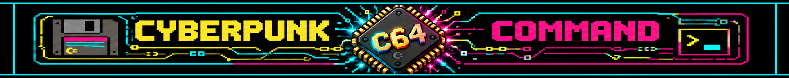

# Cyberpunk C64 Command

A C64 companion for C64 Ultimate and Ultimate 64 on macOS and Windows.

Cyberpunk C64 Command brings disk images, Ultimate files, SID music, C64 controls, media and compatible lighting together. It grew out of everyday use with a C64 close by, and from feedback from the scene.

## Version 3.11.2

One current release for:

- Apple silicon Mac · macOS 13+
- Intel Mac · macOS 13+
- Windows 10 / 11 · x64

[Download the current release](https://github.com/breadbin-runner/cyberpunk-c64-command/releases/tag/v3.11.2)

Apple silicon and Intel Mac use have been confirmed. Windows 11 has been confirmed by the author; Windows 10 is supported by the x64 package and still welcomes a confirmed report.

## What it does

- Disk Workbench for D64, D71 and D81 images
- Ultimate Files with browse, upload, download and Disk Flip sets
- Program selection and LOAD"*",8 quick start
- C64 remote control and drive functions
- Media Launcher and SID Collection
- Light Studio for case and keyboard lighting
- Local Disk Workbench can be used without an Ultimate

Hardware functions need a reachable C64 Ultimate or Ultimate 64 on the same network with the required REST and FTP services enabled.

## Download and first launch

Choose the current release above. On Mac, unzip the archive and move the app to Applications. On Windows, run the x64 installer and open Cyberpunk C64 Command from the Start menu. Runtime components are included.

The Mac app is ad-hoc signed without Apple Developer ID notarization. The Windows installer has no trusted publisher signature. The operating system may ask for approval.

The first launch opens a short setup for language, animations, the optional Ultimate address and the start view. The Ultimate address may stay empty when using the local Disk Workbench.

## Manuals and help

- [Deutsche Bedienungsanleitung](docs/Anleitung-DE.pdf)
- [English user manual](docs/Manual-EN.pdf)
- [Connection and counter information](docs/NETWORK.md)
- [Support and feedback](SUPPORT.md)
- [GitHub issues](https://github.com/breadbin-runner/cyberpunk-c64-command/issues)

## Screenshots

English and German main-menu screenshots are included in [docs](docs/).

## Project and credits

This repository provides project information, manuals and release downloads. The application source code is not published here.

Cyberpunk C64 Command is an independent fan project by Breadbin Runner. It is not affiliated with Commodore, Ultimate or the High Voltage SID Collection. Thanks to the hardware makers, HVSC maintainers and the C64 scene.

— Breadbin Runner
